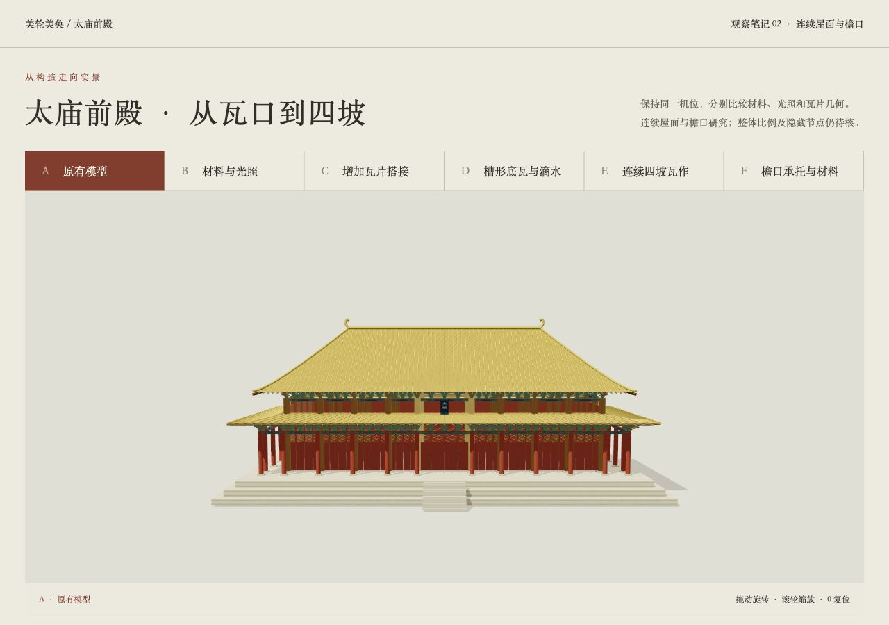
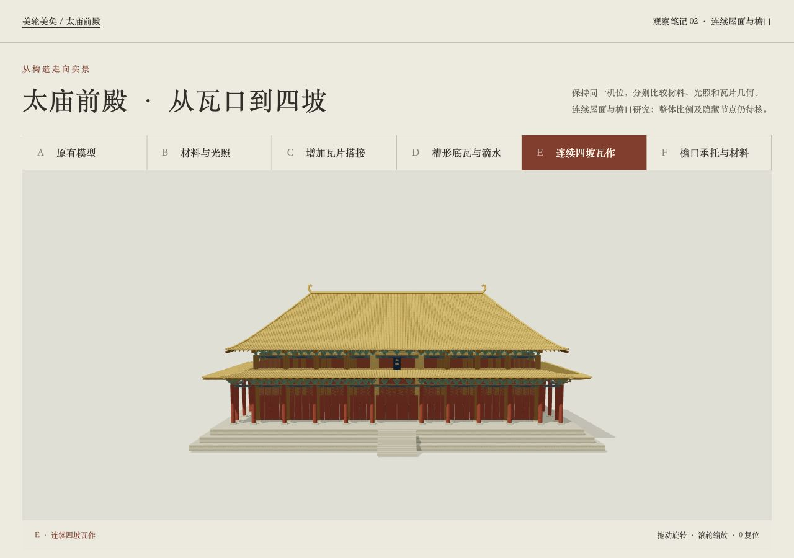
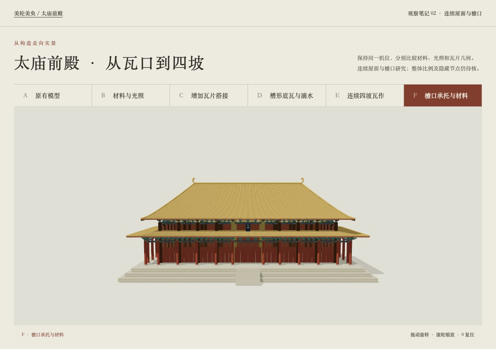
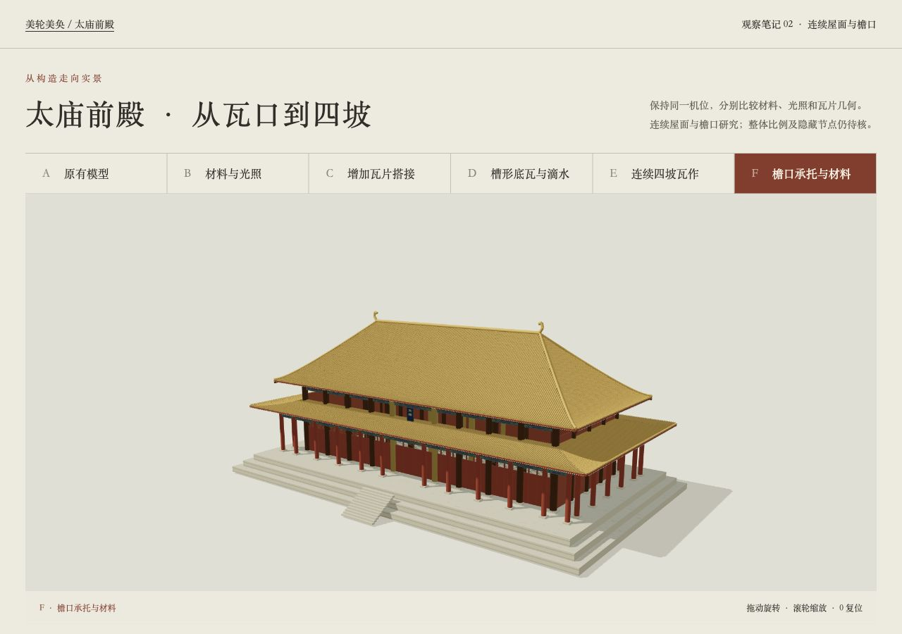
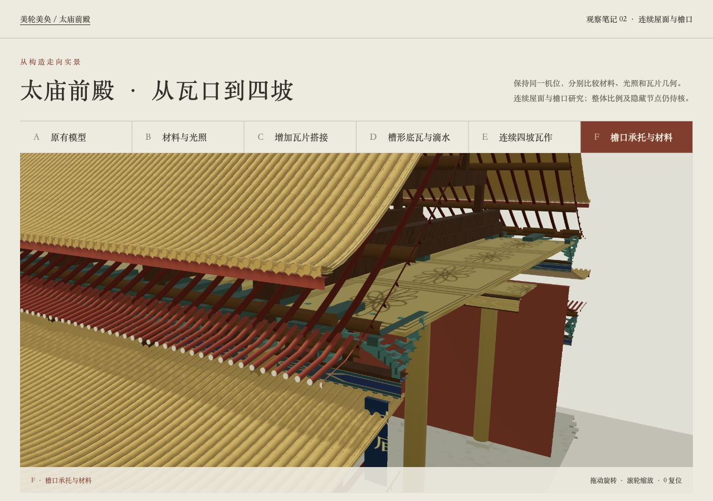
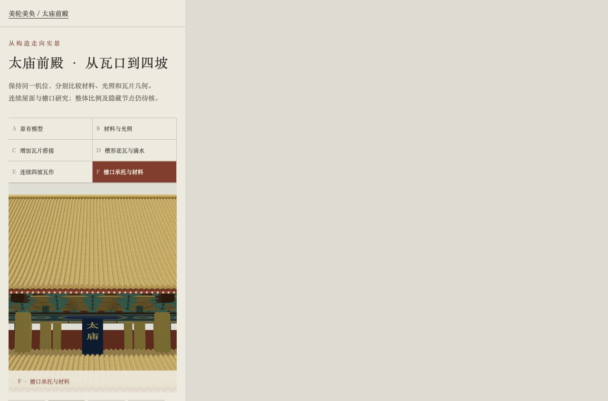

# 第二轮同机位整殿与檐口对照

2026-10-15。下列整殿截图的相机、画幅与背景一致。A为原模型，E是连续瓦作，F增加檐口与材料组合变化；不能把F的改善归因于单一变量。原始截图未裁切。

## A · 原模型

## E · 连续四坡

## F · 檐口与材料

## F · 整殿斜侧

## F · 剖切与屋面抬升

## 窄屏原始截图

390×844内窗口位于宿主页左侧，右侧为测试宿主留白，不是手机页面溢出；实际内窗口scrollWidth为390。

---

# 同机位对照

原始截图未裁切；内窗口尺寸见运行JSON。

## A

## B

## C

## D

