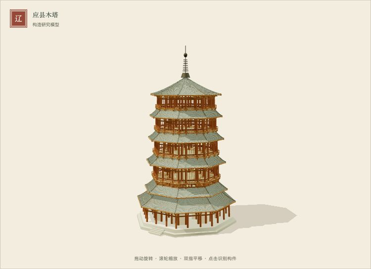
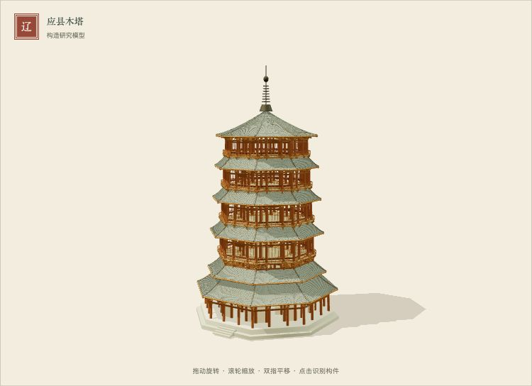
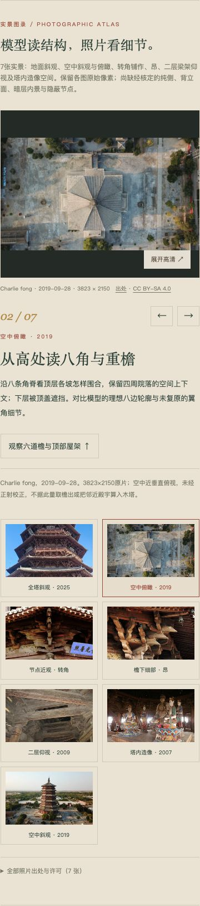

# 第三卷继续改进 · 2026-10-16

状态：本地修改，未提交、推送或发布网站。七张许可照片的28个R2对象已经上传并通过S3 API读回SHA256校验；公开HTTP仍403。开始时工作区已有02轮平柱方向修正及四图图录，本轮保留它们，不据为新发现；本轮源码基线存于 `baseline/`，历史 `updates/02/` 与 `study/runs/` 不覆盖。

## 实际改动与证据边界

- 保留五明四暗、低回廊、逐段外圈柱网、内圈推定比例、160组平柱方向修正及两类落柱。没有套用其他建筑的尺寸或节点。
- 修正六道屋面的椽体净空：椽中心相对屋面由竖直下移0.055m改为0.090m，仍为教学几何推定。斜坡上仅按半径竖移，不能使倾斜圆柱全部位于面片下；本轮检查实际圆柱顶点，包含端面及中间截面。16,128段的对应面片平面检查从全数存在微小穿出变为0，最坏法向距离由+0.020364m变为−0.001678m。这个毫米数字是软件计算结果，不是木塔实测精度。
- 检查每个顶点自身XZ位置对应的屋面，涵盖跨相邻面片：1,612,800个顶点中，61,984个位于屋面敞口/檐缘外或边界容差内，分别报告；其余有覆盖顶点未穿出，最坏法向净距约0.001680m。不将无覆盖点算成已通过遮盖，也不据此认证真实椽端构造。所有槫的有限线段范围仍有椽端包络相交，12段椽链仍连续；相交只是教学接触，不证明加工节点正确。
- 修正四个上层中心楼板扇形：保留原顶点及稳定ID，只删除32个由首尾同点产生的零面积三角面。楼板/屋面有效三角面均朝上，576个屋面面片内部边成对、仅96条内外边界边，未发现屋面接缝缺面。
- 材质、曝光、灯位不改，便于把本轮几何改动单独归因。研究页通过 `repairSurfaces:false` 保留原A/B/C/D表面条件，历史实验截图仍有原语义；正式卷默认修复。研究页脚本加版本号。
- 正式卷加载 `app.js?v=yingxian-03` 与 `model.js?v=yingxian-03`，浏览器保存实际响应字节SHA256，防止以测试源码替代实际页面版本。选中的插入柱在最大拆解后保留同一ID，世界选中框随柱上移3m。

屋面法线并未发现反向问题，因此未靠双面材质遮盖。未采用整体拉高到67.31m、据单张斜拍拟合栏板/围护、补造135°角攒互锁、将中央瓦口试件铺满全塔等方案。总高基准与独立机位不足、角部样片不连续、逐攒证据不足，均仍成立。没有新增照片配准或还原度百分比。

## 文献与照片

重新读取[UNESCO预备名录5803](https://whc.unesco.org/en/tentativelists/5803/)核对五明四暗、六檐与双圈形制。2024论文网页本轮访问失败，使用此前保存并有SHA256的出版PDF与既有图表记录；没有把失败请求写成重新读取全文。原书正文与逐页映射仍未取得。

图录在既有四图基础上新增三图，七图均亲看完整画面。来源原始元数据保存于共享 `photos/records/commons-metadata.json`；原作哈希、ICC状态、像素与本地衍生图SHA256另存 `photo-evidence.json`。

| 照片 | 作者 / 日期 / 许可 | 用途与限制 |
| --- | --- | --- |
| 全塔地面斜观 | Yumeto / 2025-06-04 / CC BY-SA 4.0 / 3072×4096 | 章节0；未配准，不推断罗盘方向或倾斜 |
| 顶盖俯瞰 | Charlie fong / 2019-09-28 / CC BY-SA 4.0 / 3823×2150 | 章节4；未经正射校正，下层被遮挡 |
| 转角铺作、昂（两图） | Gisling / 2007年10月 / CC BY 3.0 / 各1500×998 | 章节5；层位方位未核，不跳到落柱局部冒充真实角攒 |
| **二层梁架仰视** | Zeus1234 / 2009-05-29 / CC BY-SA 3.0 / 3648×2736 | 章节3；来源注明二层，非暗层全貌，隐藏连接与修缮年代未核 |
| **塔内造像空间** | Peellden / 2007-07-14 / CC BY 3.0 / 1280×851 | 章节5；层位未核，保留空间语境，不冒充高清节点图 |
| **空中斜观全塔** | Charlie fong / 2019-09-28 / CC BY-SA 4.0 / 3302×1858 | 章节0；另一摄影高度，不称纯正/侧/背立面 |

原始JPEG字节不改，WebP只等比缩小/转格式、保留ICC（如有），不裁切、增细或改色。原片保存在R2，原作链接继续直接指向Commons，站点随附21个WebP约8.0MiB。最初2019斜观下载遇429，停止该次请求，稍后重试成功并校验来源SHA1；不把失败缩略图当原片。

尚缺经方位核定的纯侧、背立面、暗层内景、真实落柱/榫卯测绘；造像照片不填补暗层或隐蔽节点缺口。没有使用其他建筑照片。

## 存储与页面交付分别验收

1. **上传/对象读回**：`r2-upload.json`、`r2-upload-interior.json`、`r2-upload-overall.json`，16+8+4个对象，独立建筑ID/原片内容哈希前缀，防覆盖写入，全部S3读回SHA256一致。使用现有环境配置，没有更改域名或访问权限，日志不含凭据。
2. **公开HTTP**：`public-access.json`逐一记录28个对象，全部403；`public-probe.json`保留首次探测。不声称CDN恢复。
3. **浏览器远程图像**：`storage-browser.json`单独记录七张远程高清的解码结果与网络失败；本机Chrome七张均未成功解码，逐请求记录为 `net::ERR_BLOCKED_BY_ORB`。命令行403与浏览器的具体失败分开报告，不能互相代替。
4. **本地交付**：本卷 `assets.json`以本地衍生图为主地址，R2地址保存在 `r2` 字段，存储状态说明已上传而公开访问失败。七图×缩略/展示/高清共21个文件实际浏览器解码通过。页面不依赖CDN恢复；原始Commons链接仍另存。共享组件的自动备用机制保留。

## 验证与复现

环境：Node、Chrome headless、Playwright；静态服务从仓库根运行于8765。自动化视口不等于真实手机GPU。为运行下列浏览器脚本，将 `PLAYWRIGHT_MODULE` 指向本机Playwright模块、`CHROME_EXECUTABLE` 指向Chrome。

```sh
node --test chinese-architecture/yingxian/tests/model.test.js chinese-architecture/yingxian/tests/study.test.js chinese-architecture/photos/catalog.test.js
node chinese-architecture/yingxian/tests/geometry-audit.mjs
node chinese-architecture/yingxian/tests/roof-footprint-audit.mjs
PREVIEW_OUTPUT=chinese-architecture/yingxian/updates/03/ node chinese-architecture/yingxian/tests/browser.mjs
node chinese-architecture/yingxian/tests/photos.mjs
node chinese-architecture/yingxian/tests/comparison.mjs
node chinese-architecture/yingxian/tests/storage-browser.mjs
```

- `tests.txt`：28项通过（正式模型14、研究适配8、图录6）；柱圈、明暗层、支承、V撑、落柱、有限槫椽接触、法线、屋面连续性、椽体净空、ID/矩阵及研究控制条件。不是文物结构认证。
- `geometry-audit.json`、`roof-footprint-audit.json`：源自真实生成几何的前后统计与边界例外。首次模型测试原始输出另存 `model-initial.txt`。
- `browser.txt`：七章节、十层隔离、五视角、双轴正反剖切及端点、最大拆解取景、真实画布拾取、图层、复位与键盘；1600×1150、390×844；第一/二卷加载烟测，未替它们宣称完整验收。
- `photos-browser.json`：七图×1280×900和390×844，高清解码、200%展开、Esc/焦点、双向章节联动和研究页加载；本地页面异常及资源失败为0。统计服务在图录测试中屏蔽。
- `comparison-browser.json`：正式新旧模型在同一当前页面壳中以路由拦截旧模型响应，五个固定相机×两设备×两条件，共20幅截图；机位逐坐标比对，实际模型响应SHA256核对。另有两设备插入柱选中框随最大拆解移动、共享preview实际进入yingxian、研究页换光。不是照片配准。保存两次runner断言错误：第一次误等闭合details内stats可见，第二次资源数量断言遗漏iframe/研究页重新请求；修正runner，没有迁就模型。

本轮全貌、剖面、暗层、顶架、落柱合/拆、最大展开、图录及手机预览均留在本目录。已目视桌面/窄屏图录、顶层屋架及固定机位前后对照。`source-hashes.json`记录最终受检源码与资产校验。历史结果不覆盖。另以 `earlier-volumes-tests.txt` 保存第一/二卷14项模型回归，全部通过。

当前仍是有来源的教学模型。完整抄平、内圈逐层实测、辅助柱与现状变形、54种铺作、角攒互锁、暗榫、栏板围护、楼梯/藻井/造像及历史彩画仍未完成；软件通过不能消除这些真实性边界。

## 固定机位预览

两图采用同一当前页面、同一1280×900视口与相机；基线仅替换为本轮保存的旧model.js。整体轮廓基本不变，不能用微小净空修正声称解决了照片中明显不同的栏板与围护。






